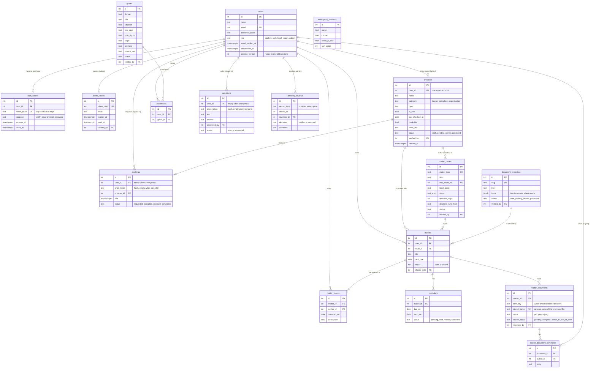

# Database design

The database is PostgreSQL 16. There are 17 tables. They are made by the numbered files in `server/src/migrations/`. This page is drawn from those files.

## The tables and how they connect

`users` also has a `pending_email` column that holds a new address until its link is used. `matters` has a `checklist_id` that is cleared if the checklist is deleted, so a checklist can never delete a matter.

`directory_reviews` points at a provider, a route or a guide through `record_type` and `record_id`. It is the log of what each expert decided. `emergency_contacts` stands alone. The urgent help page reads it and falls back to a built-in list if it is empty.

## Rules the database enforces itself

These are written as constraints so that a bug in the code cannot break them.

| Rule | How |
|---|---|
| A published guide, entry, route or checklist always names the person who published it | `CHECK (status <> 'published' OR (verified_by IS NOT NULL AND verified_at IS NOT NULL))` on `guides`, `providers`, `matter_routes` and `document_checklists` |
| A booking or a question is either signed in or anonymous, never both and never neither | `CHECK ((user_id IS NULL) <> (anon_token IS NULL))` |
| An anonymous code is unique and only its hash is stored | a unique index on `anon_token` where it is not null |
| An expert cannot accept two bookings at the same time | a unique index on `(provider_id, slot)` where the status is `accepted` |
| Only an entry with an expert account can take bookings | `CHECK (NOT bookable OR user_id IS NOT NULL)` on `providers` |
| A route has both a number of days and what they run from or neither | `CHECK ((deadline_days IS NULL) = (deadline_runs_from IS NULL))` |
| A reminder is never set for after its deadline and "sent" always has a time | `CHECK (send_on <= due_on)` and `CHECK ((status = 'sent') = (sent_at IS NOT NULL))` |
| An answered question always has an answer and an expert | `CHECK ((status = 'answered') = (answer IS NOT NULL AND answered_by IS NOT NULL))` |
| A returned review always has a reason | `CHECK (decision <> 'returned' OR comment IS NOT NULL)` |
| A matter is shared with an office or with nobody | `CHECK ((shared_with IS NULL) = (shared_at IS NULL))` |

## Choices worth knowing

- **Accounts are switched off and never deleted.** Guides and entries keep the name of the expert who checked them. A delete would break that link.
- **Dates are plain dates.** `next_due`, `send_on` and `occurred_on` are `DATE`. The server sends them as `YYYY-MM-DD` text so a deadline in Kigali never shifts a day.
- **Saved guides keep their row** when a guide goes back to draft. The save returns on its own once the guide is verified again.
- **One-time links are stored as hashes.** A database leak cannot be used to open anyone's link.
