# Database design

The database is PostgreSQL 16. There are 23 tables. They are made by the 42 numbered files in `server/src/migrations/` (001 to 042), run in order. `guide_item_checks` is created in 014 and dropped in 025, so it is not one of the 23. The `schema_migrations` table that the migration runner keeps is not counted. This page is drawn from those files.

## The tables and how they connect

```mermaid
erDiagram
    users ||--o{ auth_tokens : "has one-time links"
    users ||--o{ invite_tokens : "creates (admin)"
    users ||--o{ providers : "is the expert behind"
    users ||--o{ matters : owns
    users ||--o{ bookmarks : saves
    users ||--o{ bookings : "requests (signed in)"
    users ||--o{ questions : "asks (signed in)"
    users ||--o{ directory_reviews : "records a decision"
    users ||--o{ matter_events : writes
    users ||--o{ matter_documents : "checks (expert)"
    users ||--o{ matter_document_comments : "writes (expert)"
    providers ||--o{ matter_routes : "is the first office of"
    providers ||--o{ bookings : "receives"
    providers ||--o{ matters : "is shared with"
    providers ||--o{ provider_availability : "has weekly hours"
    matter_routes ||--o{ matters : "starts"
    matters ||--o{ matter_events : "has a record of"
    matters ||--o{ reminders : "has"
    document_checklists ||--o{ matters : "is followed by"
    matters ||--o{ matter_documents : "holds"
    matter_events ||--o| matter_event_files : "may carry one file"
    matters ||--o{ matter_event_files : "holds"
    matter_documents ||--o{ matter_document_comments : "has"
    guides ||--o{ bookmarks : "is saved in"
    guides ||--o{ document_checklists : "is the source of"
    bookings ||--o{ booking_reminders : "has"

    users {
        int id PK
        text name
        text email UK
        text password_hash
        text role "student, staff, legal_expert or admin"
        timestamptz email_verified_at
        timestamptz deactivated_at
        int session_version "raised to end old sessions"
        timestamptz created_at
        text pending_email "new address until its link is used"
    }
    auth_tokens {
        int id PK
        int user_id FK
        text token_hash UK "only the hash is kept"
        text purpose "verify_email, reset_password or change_email"
        timestamptz expires_at
        timestamptz used_at
        timestamptz created_at
    }
    invite_tokens {
        int id PK
        text token_hash UK "only the hash is kept"
        text email
        timestamptz expires_at
        timestamptz used_at
        int created_by FK
        timestamptz created_at
    }
    providers {
        int id PK
        int user_id FK "the expert account, may be empty"
        text name
        text category "lawyer, consultant or organisation"
        text type "one of twelve kinds of body"
        text location
        text contact
        text services
        text languages
        bool is_free
        text official_source_url
        date last_checked_at
        text status "draft or published"
        int verified_by FK "the admin who published it"
        timestamptz verified_at
        timestamptz created_at
        timestamptz updated_at
        bool bookable "needs an expert account"
        text meet_link "https://meet.google.com only"
        text address
        text hours
        text address_note
        timestamptz availability_set_at "empty until hours are first saved"
    }
    matter_routes {
        int id PK
        text matter_type UK
        text title
        text keywords
        int first_forum_id FK
        text legal_basis
        text exclusions
        text_array steps
        int deadline_days "above zero, or empty"
        text deadline_runs_from "empty only with no days"
        text deadline_note
        text status "draft or published"
        int verified_by FK "the admin who published it"
        timestamptz verified_at
        timestamptz created_at
        timestamptz updated_at
        tsvector tsv "generated from title and keywords"
        text area "one of the six areas, or empty"
    }
    guides {
        int id PK
        text domain "one of the six areas"
        text title
        text situation
        text law_says
        text your_rights
        text steps
        text get_help
        text source_law
        text source_url
        text status "draft, published or withdrawn"
        int verified_by FK "the admin who published it"
        timestamptz verified_at
        timestamptz created_at
        timestamptz updated_at
        jsonb service "the how-to block"
        text summary "280 characters at most"
    }
    directory_reviews {
        int id PK
        text record_type "provider, route or guide"
        int record_id "no foreign key"
        int reviewer_id FK
        text decision "published, returned, verified or withdrawn"
        text comment
        timestamptz created_at
    }
    bookings {
        int id PK
        int user_id FK "empty when anonymous or erased"
        text anon_token "hash, empty when signed in"
        int provider_id FK
        timestamptz slot
        text topic "emptied when the person erases their account"
        text status "requested, accepted, declined, completed or cancelled"
        timestamptz created_at
        text room_name "the Daily room, 32 hex characters"
        timestamptz room_created_at
        timestamptz proposed_slot "only while the status is requested"
        timestamptz proposed_at
    }
    questions {
        int id PK
        int user_id FK "empty when anonymous"
        text anon_token "hash, empty when signed in"
        text text
        text answer
        int answered_by FK
        text status "open or answered"
        timestamptz created_at
        timestamptz answered_at "empty for answers given before it existed"
    }
    matters {
        int id PK
        int user_id FK
        int route_id FK
        text title
        text next_action
        date next_due
        text status "open or closed"
        int shared_with FK "a directory entry, or empty"
        timestamptz shared_at
        timestamptz created_at
        timestamptz updated_at
        int checklist_id FK "cleared if the checklist is deleted"
    }
    matter_events {
        int id PK
        int matter_id FK
        int author_id FK
        date occurred_on
        text description
        timestamptz created_at
        text kind "entry (the owner) or system (the application or a lawyer)"
    }
    reminders {
        int id PK
        int matter_id FK
        date due_on
        date send_on
        text status "pending, sent, missed or cancelled"
        timestamptz sent_at
        timestamptz created_at
    }
    document_checklists {
        int id PK
        text slug UK
        text title
        text description
        jsonb items "the documents a task needs"
        text status "draft or published"
        text review_comment
        int verified_by FK "the admin who published it"
        timestamptz verified_at
        timestamptz created_at
        timestamptz updated_at
        int guide_id FK "the guide it was based on, may be empty"
    }
    matter_documents {
        int id PK
        int matter_id FK
        text label "120 characters at most"
        text item_key "the checklist item it answers, may be empty"
        text stored_name UK "random 32 hex characters"
        text mime "pdf, png or jpeg"
        int size_bytes
        text sha256
        text iv
        text auth_tag
        bytea content "the encrypted bytes, kept in the database"
        text review_status "pending, complete, needs_fix or out_of_date"
        text review_note
        int reviewed_by FK
        timestamptz reviewed_at
        timestamptz uploaded_at
    }
    matter_document_comments {
        int id PK
        int document_id FK
        int author_id FK
        text body "1000 characters at most"
        timestamptz created_at
    }
    matter_event_files {
        int id PK
        int matter_id FK
        int event_id FK, UK "one file for each entry"
        text stored_name UK "random 32 hex characters"
        text original_name "cleaned, 120 characters at most"
        text mime "pdf, png or jpeg"
        int size_bytes
        text sha256
        text iv
        text auth_tag
        bytea content "the encrypted bytes, kept in the database"
        timestamptz created_at
    }
    bookmarks {
        int id PK
        int user_id FK
        int guide_id FK
        timestamptz created_at
    }
    emergency_contacts {
        int id PK
        text name
        text contact
        text when_to_use
        int sort_order "0 to 10000, default 100"
        timestamptz created_at
        timestamptz updated_at
    }
    dispute_ladder_steps {
        int id PK
        int position "the order on screen, 1 to 99"
        text title "120 characters at most"
        text tagline "120 characters at most"
        text description "1000 characters at most"
        text law_cited "200 characters at most"
        text status "draft or published"
        timestamptz updated_at
    }
    reports {
        int id PK
        text type "info, office, broken, safety or idea"
        text about_kind "guide, route, provider or page"
        int about_id "no foreign key"
        text about_label "200 characters at most"
        text message "10 to 2000 characters"
        text reply_channel "code or email"
        text code_hash UK "hash of the one-time code, never the code"
        text contact_email "kept only until the reply is sent"
        text status "received, in_progress or resolved"
        text admin_reply "1000 characters at most"
        timestamptz read_at
        timestamptz resolved_at
        timestamptz created_at
        timestamptz updated_at
    }
    email_sends {
        date day PK "the day in Kigali"
        int count "emails sent that day, never below zero"
    }
    provider_availability {
        int id PK
        int provider_id FK
        smallint weekday "1 Monday to 7 Sunday"
        smallint start_minute "minutes after midnight, on the half hour"
        smallint end_minute "minutes after midnight, on the half hour"
    }
    booking_reminders {
        int id PK
        int booking_id FK
        text recipient "owner or lawyer"
        text kind "day or hour"
        timestamptz send_at
        text status "pending, sent, missed or cancelled"
        timestamptz sent_at
    }
```

## What each table is for

- `users` holds every account. `session_version` goes up to end the sessions of an account. `pending_email` holds a new address until its link is used.
- `auth_tokens` holds one-time links for verifying an address, resetting a password and confirming an email change. Only a hash is kept.
- `invite_tokens` holds the invitations for legal experts. Only a hash is kept.
- `providers` is the directory. An entry has an expert account only when it takes bookings. `availability_set_at` is empty until the lawyer first saves hours.
- `provider_availability` holds a lawyer's weekly consultation hours, one row for each window, in Kigali time. While `availability_set_at` is empty the standard hours (Monday to Friday, 09:00 to 17:00) apply and no rows are needed. A saved empty list means bookings are closed on purpose.
- `matter_routes` says where a kind of matter goes first, with the law, the steps and the deadline.
- `guides` holds the legal guides. `service` holds the how-to block (the portal, the fees, the documents, the offices and the steps) and is part of the guide row.
- `directory_reviews` is the log of each publish, return and withdrawal. It points at a provider, a route or a guide through `record_type` and `record_id` and has no foreign key on `record_id`.
- `bookings` holds consultation requests. `room_name` is the video room made the first time someone joins an accepted booking. `proposed_slot` is a time the lawyer suggested, kept only while the booking is still a request. `booking_reminders` holds the reminders 24 hours and 1 hour before an accepted consultation, one row for each person and kind. It goes when its booking goes.
- `questions` holds questions for a legal expert, signed in or anonymous.
- `matters`, `matter_events` and `reminders` hold a person's own record of a legal problem. `matter_events.kind` tells a line the owner wrote (`entry`) from a line the application or a lawyer wrote (`system`). Only the owner's own `entry` lines can be deleted, with their file.
- `document_checklists` lists the documents a task needs. A matter can follow one through `matters.checklist_id`, which is cleared if the checklist is deleted, so a checklist can never delete a matter.
- `matter_documents` holds the documents a person attaches to a matter and `matter_document_comments` holds a lawyer's comments on one. `matter_event_files` holds the optional file on a line of the record. Both file tables keep the encrypted bytes in `content`. Nothing is written to disk. A row with no `content` (one written before migration 041) answers "Could not read that document" or "Could not read that file".
- `emergency_contacts` stands alone. The urgent help page reads it and falls back to a built-in list if it is empty.
- `dispute_ladder_steps` stands alone. Its steps are shown only when published.
- `reports` holds reports of a problem on the site. It has no account and no IP address. `about_kind` and `about_id` name the page reported on, with no foreign key, so a report outlives the record it was about.
- `email_sends` stands alone. It holds one row for each Kigali day with the number of emails sent, so the daily email budget is shared by every server process.

Statuses are `draft` and `published` for the directory, routes, checklists and ladder steps and `draft`, `published` or `withdrawn` for guides. The checks on the publishable tables still allow a third value, `pending_review`, that the application never writes.

## Rules the database enforces itself

These are written as constraints so that a bug in the code cannot break them.

| Rule | How |
|---|---|
| A published guide, entry, route or checklist always names the admin who published it | `CHECK (status <> 'published' OR (verified_by IS NOT NULL AND verified_at IS NOT NULL))` on `guides`, `providers`, `matter_routes` and `document_checklists` (`*_published_is_verified`) |
| A guide's area is one of six values | `CHECK (domain IN ('tenancy', 'employment', 'business', 'immigration', 'harassment', 'vehicles'))` on `guides`. The same list is the `area` of a route |
| A guide summary is at most 280 characters | `CHECK (summary IS NULL OR char_length(summary) <= 280)` |
| A guide's status is draft, published or withdrawn | `CHECK` on `guides.status` |
| A question is either signed in or anonymous, never both and never neither | `CHECK ((user_id IS NULL) <> (anon_token IS NULL))` on `questions` |
| An answered question always has an answer and an expert | `CHECK ((status = 'answered') = (answer IS NOT NULL AND answered_by IS NOT NULL))` on `questions` |
| A booking is never both signed in and anonymous. After a person erases their account it has neither, so the lawyer keeps the booking with no name | `CHECK (user_id IS NULL OR anon_token IS NULL)` on `bookings` |
| A booking's status is one of five values | `CHECK (status IN ('requested', 'accepted', 'declined', 'completed', 'cancelled'))` on `bookings` |
| A suggested time exists only while the booking is a request | `CHECK (proposed_slot IS NULL OR status = 'requested')` on `bookings` |
| An anonymous code is unique and only its hash is stored | a unique index on `anon_token` where it is not null, on `questions` and `bookings`. Migration 034 hashed codes that were stored in plain text |
| An expert cannot accept two bookings at the same time | a unique index on `(provider_id, slot)` where the status is `accepted` |
| A video room name is 32 hex characters | `CHECK (room_name IS NULL OR room_name ~ '^[0-9a-f]{32}$')` on `bookings` |
| Only an entry with an expert account can take bookings | `CHECK (NOT bookable OR user_id IS NOT NULL)` on `providers` |
| A route has both a number of days and what they run from or neither | `CHECK ((deadline_days IS NULL) = (deadline_runs_from IS NULL))` on `matter_routes`. A day count is above zero |
| A consultation window starts and ends on the half hour and fits in the day | `CHECK` on `provider_availability`, with one row for each `(provider_id, weekday, start_minute)`. Windows on one day must not overlap. The application checks that, because a table cannot |
| A reminder is never set for after its deadline and "sent" always has a time | `CHECK (send_on <= due_on)` and `CHECK ((status = 'sent') = (sent_at IS NOT NULL))` on `reminders` |
| A booking reminder has one row for each person and kind and "sent" always has a time | `UNIQUE (booking_id, recipient, kind)` and `CHECK ((status = 'sent') = (sent_at IS NOT NULL))` on `booking_reminders` |
| A matter is shared with an office or with nobody | `CHECK ((shared_with IS NULL) = (shared_at IS NULL))` on `matters` |
| A returned or withdrawn review always has a reason | `CHECK (decision NOT IN ('returned', 'withdrawn') OR comment IS NOT NULL)` on `directory_reviews` |
| A review's record type and decision are known values | `CHECK` on `directory_reviews.record_type` (provider, route, guide) and `directory_reviews.decision` (published, returned, verified, withdrawn) |
| A matter document's verdict has a reviewer and a time and a pending one has neither | `CHECK ((review_status = 'pending') = (reviewed_by IS NULL AND reviewed_at IS NULL))` on `matter_documents` |
| A matter document's file type is PDF, PNG or JPEG and its size is above zero | `CHECK` on `matter_documents.mime` and `matter_documents.size_bytes`. The same for `matter_event_files` |
| A matter has one file for each checklist item | a unique index on `(matter_id, item_key)` where the item key is not null, on `matter_documents`. A replacement swaps the row in one transaction |
| A stored file's name is 32 random hex characters | `CHECK (stored_name ~ '^[a-f0-9]{32}$')` on `matter_documents` and `matter_event_files` |
| An entry has at most one file | a unique `event_id` on `matter_event_files` |
| A file's bytes are kept in the row | `content bytea` on `matter_documents` and `matter_event_files`. Rows written before migration 041 have no content |
| A report's reply channel is code or email and each has only its own detail | `CHECK` on `reports`: a code report has a hash and no address and an email report has no hash |
| A resolved report has a time and only a resolved one does | `CHECK ((status = 'resolved') = (resolved_at IS NOT NULL))` on `reports` |
| A report's code hash is unique | a unique index on `reports.code_hash` where it is not null |
| A dispute ladder step's position is from 1 to 99 and its text is within its limits | `CHECK` on `dispute_ladder_steps` |
| An emergency contact has a sort order from 0 to 10000 | `CHECK` on `emergency_contacts` |
| The daily email count is never below zero | `CHECK (count >= 0)` on `email_sends` |
| An account's email address is unique and so is each one-time link's hash | `UNIQUE` on `users.email`, `auth_tokens.token_hash` and `invite_tokens.token_hash` |

## Choices worth knowing

- **Admin and legal expert accounts are switched off and never deleted.** Guides and entries keep the name of the person who published them. A delete would break that link. A student or staff member can erase their own account. That removes their matters and files, saved guides, sign-in links and questions. A booking they made stays for the lawyer with no name, account or topic.
- **Dates are plain dates.** `next_due`, `send_on`, `occurred_on`, `last_checked_at` and `due_on` are `DATE`. The server sends them as `YYYY-MM-DD` text so a deadline in Kigali never shifts a day.
- **Saved guides keep their row** when a guide goes back to draft or is withdrawn. The save returns on its own once the guide is published again.
- **One-time links and anonymous codes are stored as hashes.** A database leak cannot be used to open anyone's link or read anyone's answer.
- **Files are kept in the database.** The encrypted bytes, the checksum, the IV and the authentication tag are all stored in the row. The key is read from the server's environment and is not in the database.
